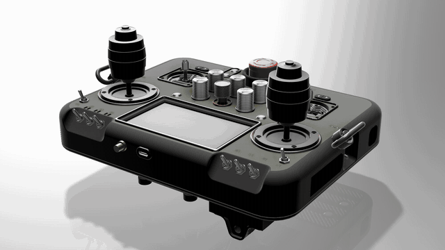
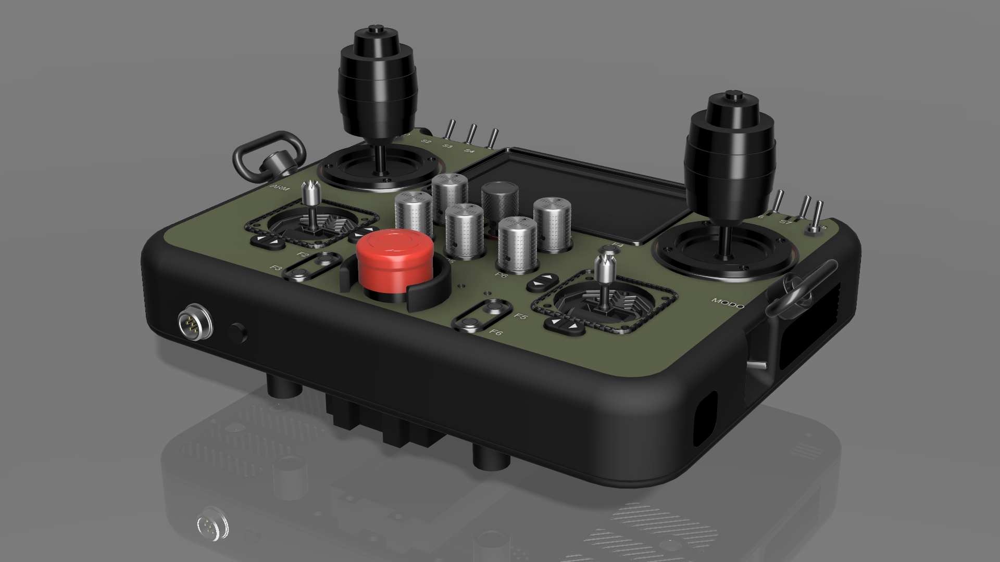
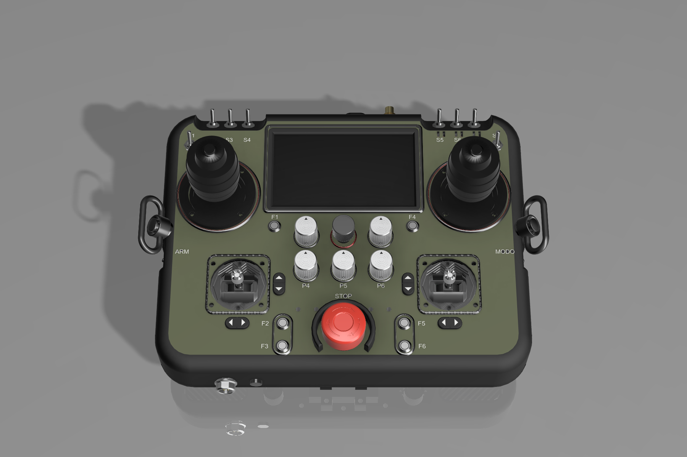
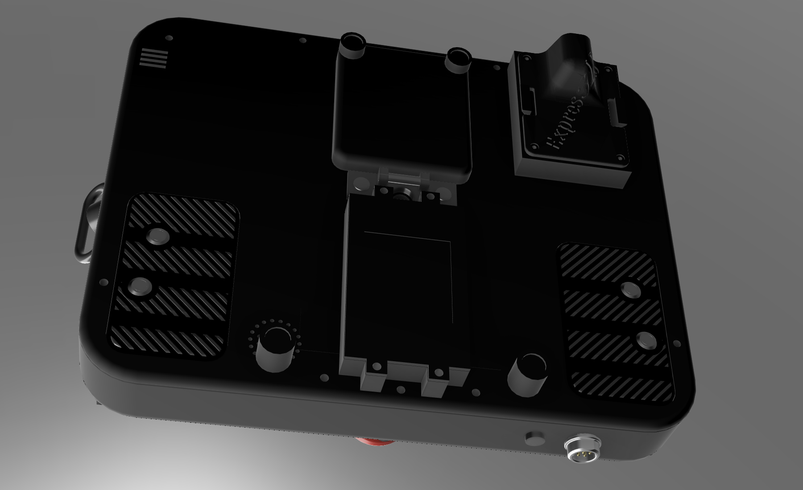
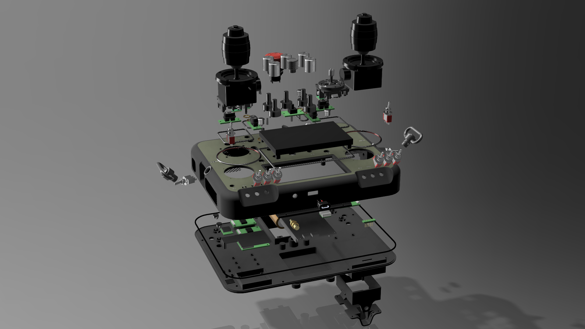
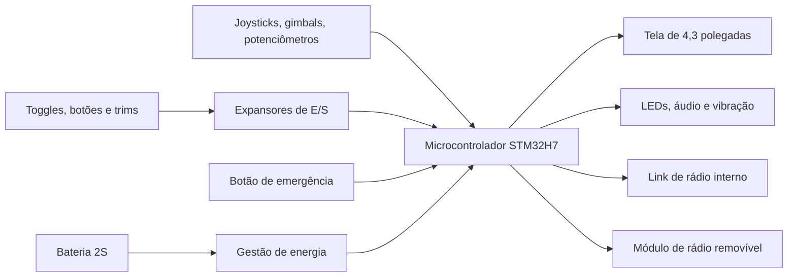
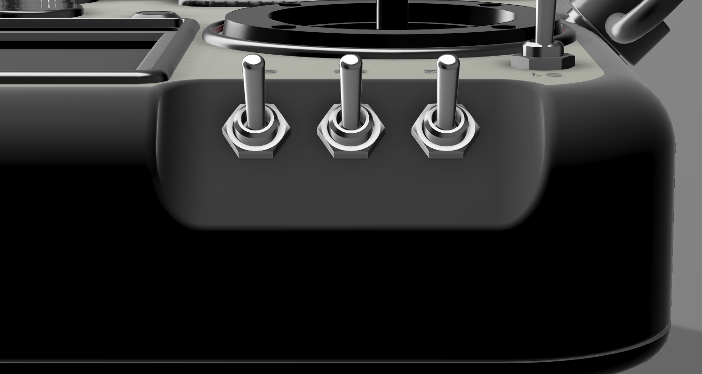
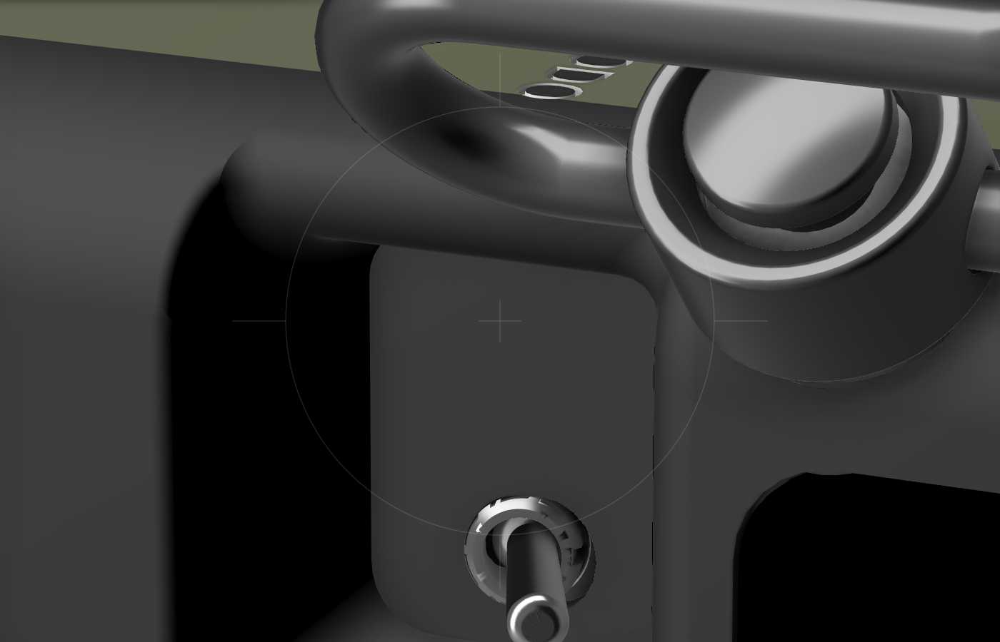
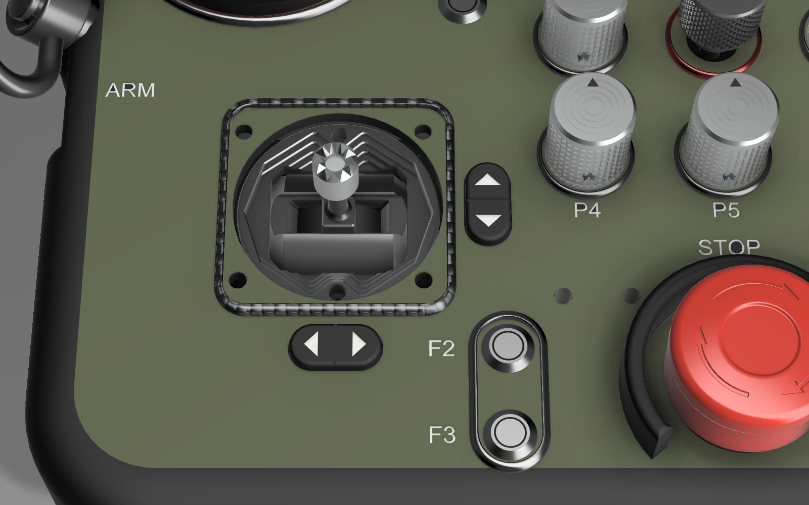

# Controle para robótica e drones

Projeto mecânico e visual de um controle portátil de alta densidade de comandos, pensado para operar robôs e drones em campo. A carcaça tem 250 × 195 mm e reúne joysticks de 3 eixos, gimbals, botão de emergência físico, tela de 4,3" e dois links de rádio.

[Assista à demonstração completa](media/demonstracao.mp4): giro de 360°, vista explodida e remontagem.

> **Status:** projeto mecânico e visual concluído em CAD. Elétrica e firmware estão em desenvolvimento, e ainda não há protótipo físico.

## Destaques

| Área | O que o projeto reúne |
|---|---|
| Comandos analógicos | 2 joysticks de 3 eixos, 2 gimbals e 5 potenciômetros |
| Comandos digitais | 10 toggles M6, 10 botões, 4 balancins de trim e seletor rotativo de 7 posições |
| Segurança | Botão de emergência físico, com guarda contra acionamento acidental |
| Rádio | Dois links independentes, sendo um interno e um módulo removível |
| Energia | 2 células 21700 em série, com porta de acesso na tampa |
| Conectividade | USB-C de painel, jack de trainer e conector circular de expansão |
| Ergonomia | Grips de TPU, botões traseiros, alça com engate QD e vibração nas empunhaduras |

## O controle

| Painel | Traseira |
|---|---|
|  |  |

## Vista explodida

## Arquitetura prevista

A arquitetura elétrica ainda está em definição, e este diagrama pode mudar.

## Desafios de projeto

### Densidade de comandos em 250 mm

A largura da carcaça foi limitada a 250 mm. O layout precisou acomodar todos os comandos, os envelopes de movimento e a eletrônica interna, com checagens de interferência entre os componentes.

### Superfícies e acabamento

As transições foram refinadas com base em revisão visual detalhada.

| Chanfro dos toggles | Rebaixo lateral | Trims |
|---|---|---|
|  |  |  |

- As placas dos toggles deixaram de parecer peças aplicadas e passaram a ter cantos arredondados e transição contínua com a carcaça.
- Os toggles foram redistribuídos em espaçamento uniforme de 12,5 mm.
- Os rebaixos laterais foram remodelados para que as paredes sigam contínuas até a curva da carcaça.
- Os balancins ganharam acabamento fosco, setas em baixo relevo e divisão central.

### Orçamento de entradas e saídas

O levantamento dos sinais mostrou de 31 a 39 entradas digitais, conforme o tipo dos toggles. Dois expansores de 16 linhas não bastariam, e isso levou à inclusão de um terceiro, ainda na fase de CAD.

### Animação gerada por script

O vídeo foi produzido com scripts na API do Fusion 360, que posicionam peças e câmera a cada quadro e restauram o modelo ao final.

## Ferramentas

- Autodesk Fusion 360 e sua API em Python
- Claude Code, como apoio na automação do CAD
- FFmpeg, para montagem do vídeo

## Como foi feito

Requisitos, decisões de projeto e revisão visual foram conduzidos por mim. A execução no CAD, os scripts e parte da documentação foram feitos com apoio de IA.

## Sobre este repositório

Este repositório é apenas uma apresentação do projeto. Arquivos CAD, lista completa de materiais, esquemáticos e firmware não são públicos.

© Todos os direitos reservados. Veja [LICENSE](LICENSE).
