# Controle para robótica e drones

Projeto mecânico e visual de um controle portátil de alta densidade de comandos, pensado para operar robôs e drones em campo. A carcaça tem 250 × 195 mm e reúne joysticks de 3 eixos, gimbals, botão de emergência físico, tela de 4,3" e dois links de rádio.

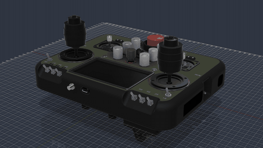

[Assista à demonstração completa](media/demonstracao.mp4): giro de 360°, vista explodida e remontagem.

> **Status:** projeto mecânico e visual concluído em CAD. Agora está na fase de protótipo: a versão atual do modelo recebe módulos prontos numa placa principal provisória, e a elétrica e o firmware seguem em desenvolvimento.

## Destaques

| Área | O que o projeto reúne |
|---|---|
| Comandos analógicos | 2 joysticks de 3 eixos, 2 gimbals e 6 potenciômetros |
| Comandos digitais | 10 toggles M6, 10 botões, 4 balancins de trim e seletor rotativo de 7 posições |
| Segurança | Botão de emergência físico, com guarda contra acionamento acidental |
| Rádio | Dois links independentes, sendo um interno e um módulo removível |
| Energia | 2 células 21700 em série, com BMS, carga pelo USB-C, porta de acesso na tampa e interruptor geral |
| Conectividade | USB-C de painel na borda frontal (carga e joystick USB no PC) e conector circular de expansão |
| Ergonomia | Grips de TPU, botões traseiros, ponto único de alça no centro de massa e vibração nas empunhaduras |

## O controle

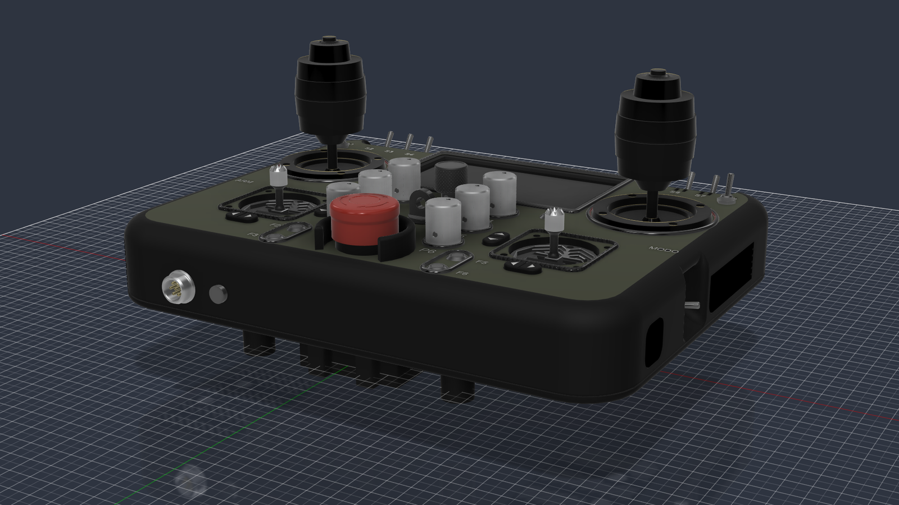

| Painel | Traseira |
|---|---|
| 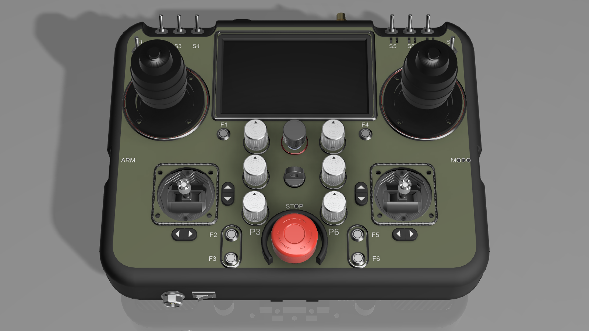 | 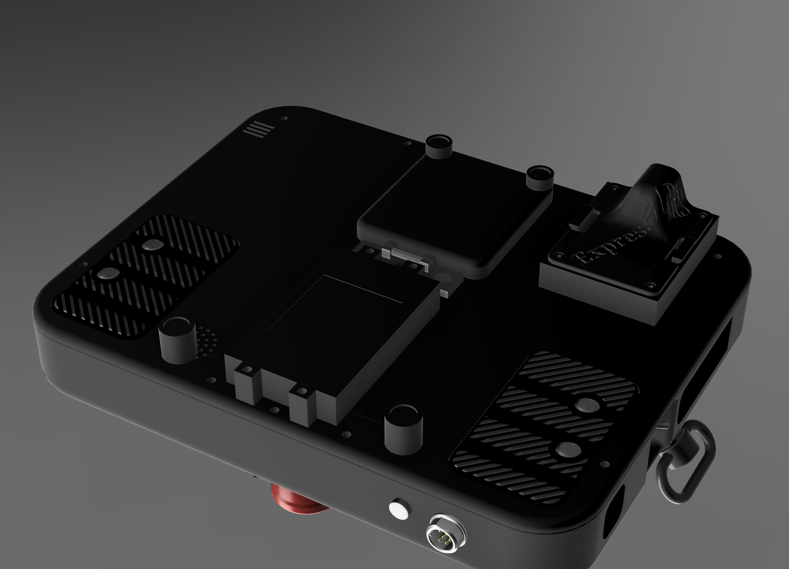 |

## Vista explodida

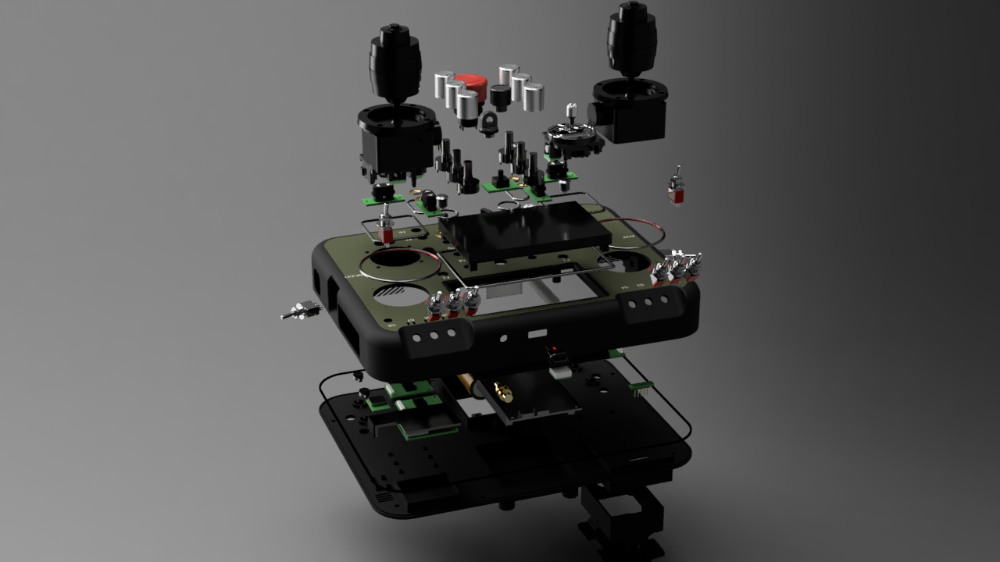

## Arquitetura prevista

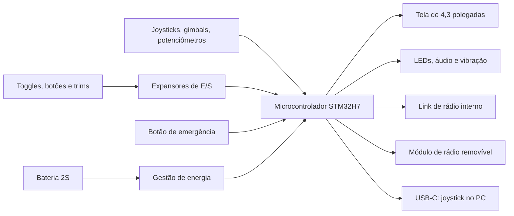

A arquitetura elétrica ainda está em definição, e este diagrama pode mudar.

## Versão de protótipo

Para montar o primeiro protótipo à mão, o modelo ganhou uma versão própria. Ela usa a placa de desenvolvimento do microcontrolador e módulos prontos encaixados numa placa principal provisória. A placa definitiva, com tudo integrado, vem depois.

| Interior do protótipo | Tampa de acesso frontal |
|---|---|
| 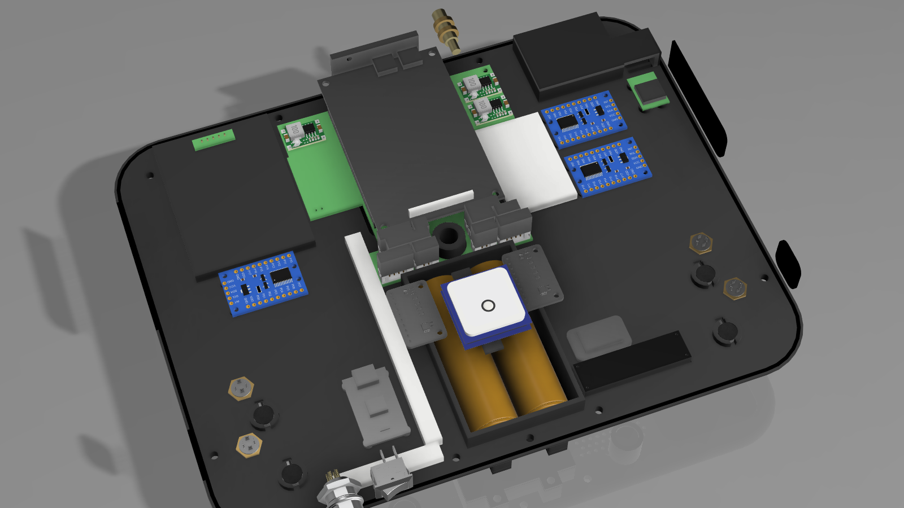 | 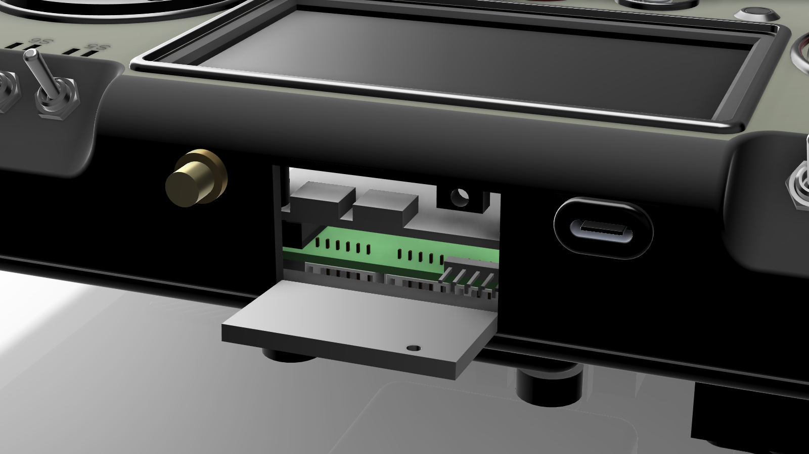 |

- **Acesso de desenvolvimento:** uma tampa na borda frontal abre para baixo, como um capô, e dá acesso às portas USB da placa de desenvolvimento e ao conector de gravação, sem abrir a tampa traseira. Ela gira em pinos impressos na própria peça e fecha com um parafuso.
- **USB-C de painel na frente:** a porta de uso final carrega a bateria e faz o controle aparecer no PC como joystick USB. Ela fica separada das ligações de desenvolvimento. O furo segue o contorno do encaixe do conector, com rebaixo interno para as travas.
- **Interruptor geral:** o jack de trainer saiu e deu lugar a um interruptor tipo gangorra, na borda inferior, ao lado do conector circular.
- **Fixação:** os pontos que são desmontados recebem insertos de latão aplicados a quente e parafusos Torx, com só duas pontas de chave no controle todo.

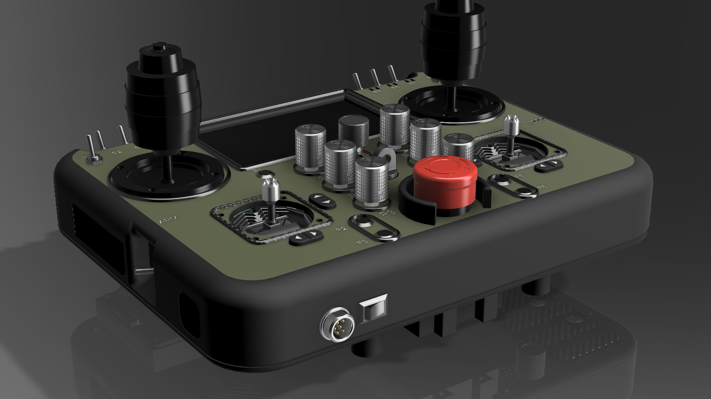

## Desafios de projeto

### Densidade de comandos em 250 mm

A largura da carcaça foi limitada a 250 mm. O layout precisou acomodar todos os comandos, os envelopes de movimento e a eletrônica interna, com checagens de interferência entre os componentes.

### Superfícies e acabamento

As transições foram refinadas com base em revisão visual detalhada.

| Chanfro dos toggles | Rebaixo lateral |
|---|---|
| 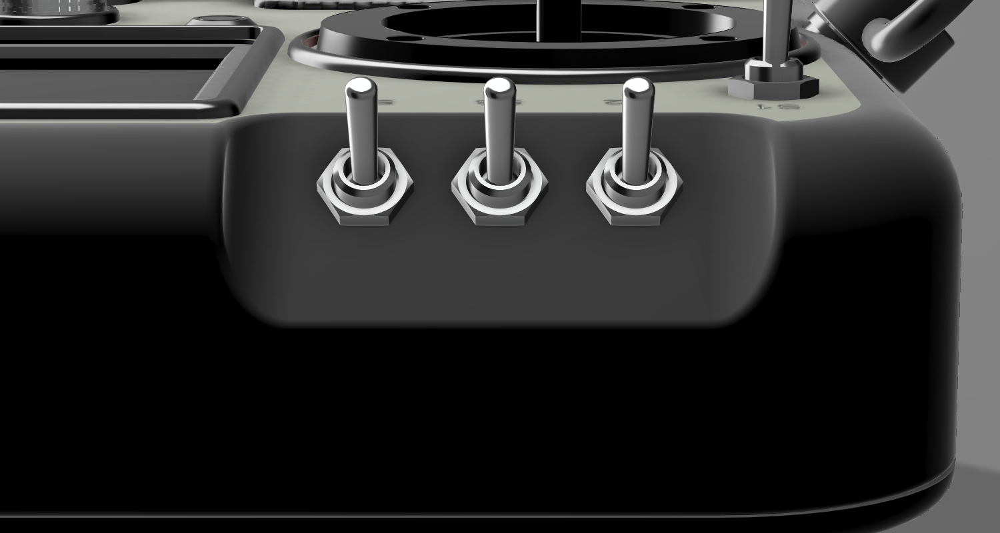 | 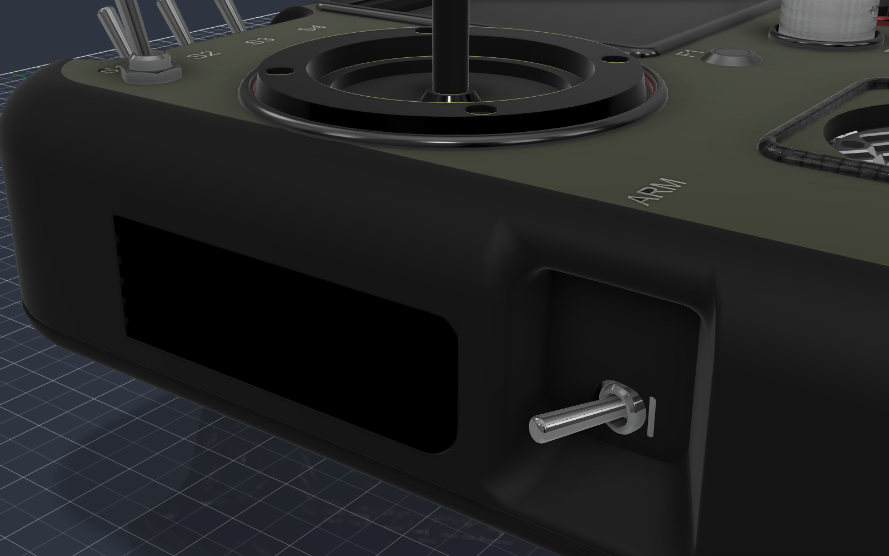 |

- As placas dos toggles deixaram de parecer peças aplicadas e passaram a ter cantos arredondados e transição contínua com a carcaça.
- Os toggles foram redistribuídos em espaçamento uniforme de 12,5 mm.
- Os rebaixos laterais foram remodelados para que as paredes sigam contínuas até a curva da carcaça.
- Os balancins ganharam acabamento fosco, setas em baixo relevo e divisão central.
- Os LEDs de status do painel foram retirados, porque a tela já mostra essas informações. Ficaram só os LEDs dos próprios botões.

### Alça e equilíbrio

O controle pesa perto de 1,9 kg e é usado pendurado no pescoço enquanto as mãos operam os gimbals. Foram estudados pontos de alça nas laterais, na tampa traseira e na borda inferior. Nas laterais, a alça cruzava os antebraços. Na tampa, ela raspava na carcaça. Na borda inferior, o controle pendia para a frente e forçava as mãos contra os gimbals.

A solução foi calcular o centro de massa e reorganizar o centro do painel em volta dele. Os potenciômetros passaram a seis, três de cada lado com 25 mm entre centros para caber os dedos. O seletor rotativo ficou no centro, e a alça prende num único olhal giratório logo abaixo. Por baixo do painel, o olhal fixa numa porca presa num alojamento sextavado, com disco de apoio e nervuras em cruz. Assim a força da alça se espalha pelo painel em vez de ficar só na rosca.

| Centro do painel | Olhal da alça |
|---|---|
| 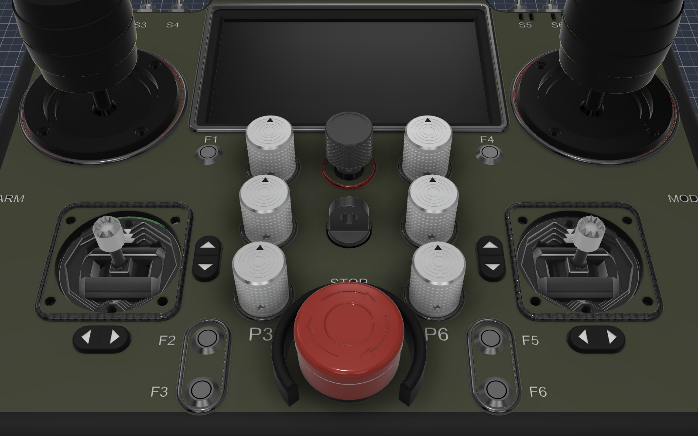 | 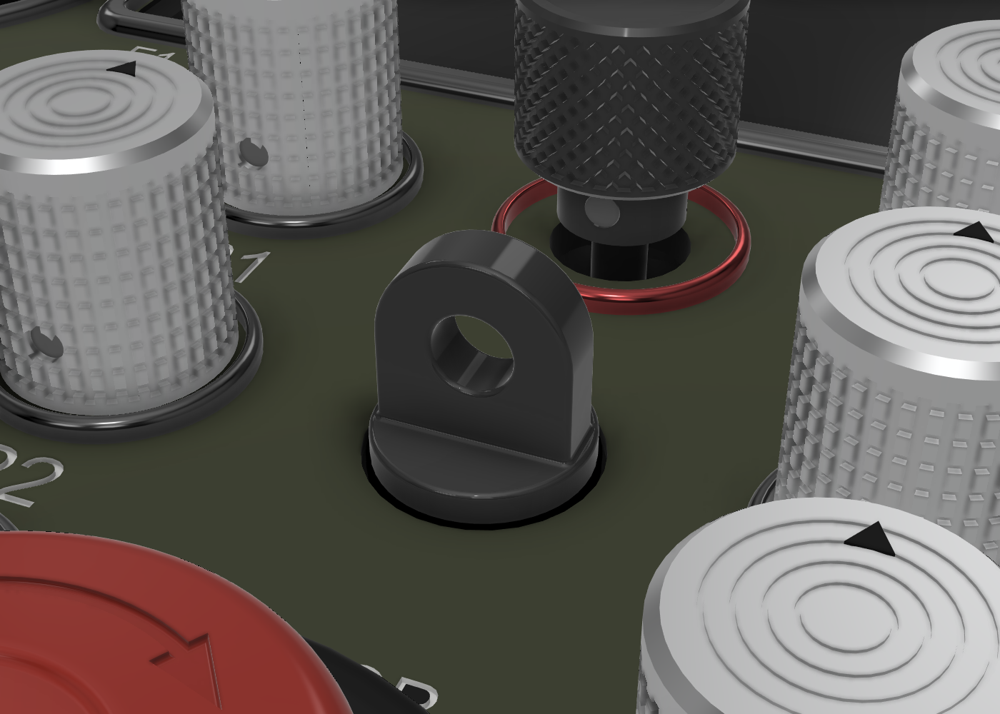 |

### Orçamento de entradas e saídas

O levantamento dos sinais mostrou de 31 a 39 entradas digitais, conforme o tipo dos toggles. Dois expansores de 16 linhas não bastariam, e isso levou à inclusão de um terceiro, ainda na fase de CAD.

### Animação gerada por script

O vídeo foi produzido com scripts na API do Fusion 360, que posicionam peças e câmera a cada quadro e restauram o modelo ao final. Nesta atualização, os 228 quadros da versão de protótipo foram capturados direto da área de trabalho do Fusion em 720p, em lotes curtos para não travar o programa.

## Ferramentas

- Autodesk Fusion 360 e sua API em Python
- Claude Code, como apoio na automação do CAD
- FFmpeg, para montagem do vídeo

## Como foi feito

Requisitos, decisões de projeto e revisão visual foram conduzidos por mim. A execução no CAD, os scripts e parte da documentação foram feitos com apoio de IA.

## Sobre este repositório

Este repositório é apenas uma apresentação do projeto. Arquivos CAD, lista completa de materiais, esquemáticos e firmware não são públicos.

© Todos os direitos reservados. Veja [LICENSE](LICENSE).
